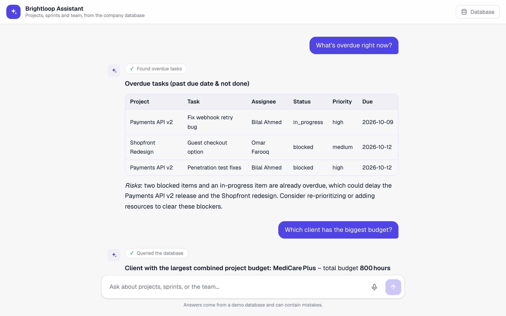
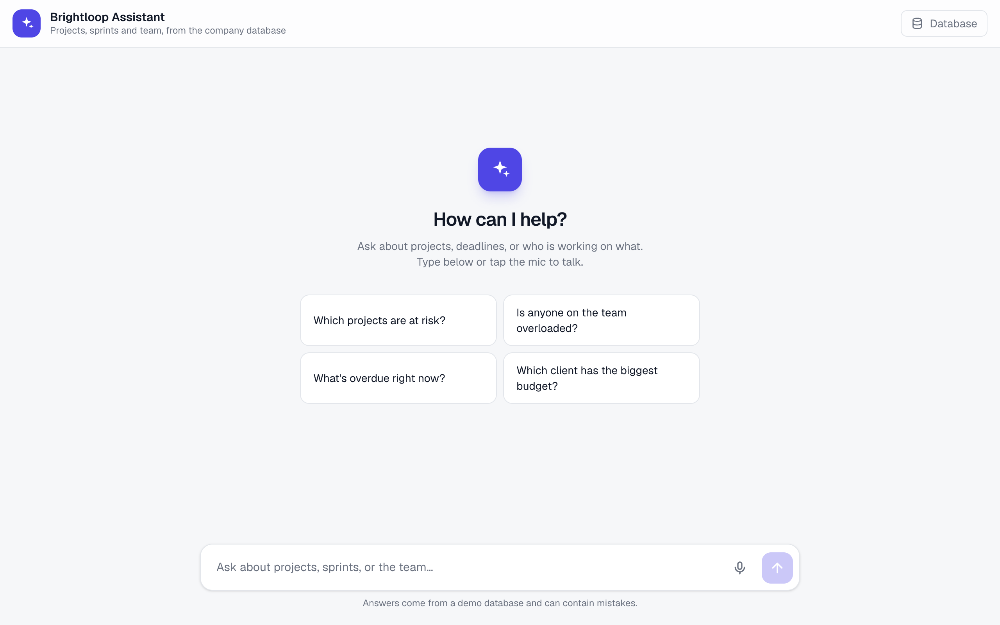
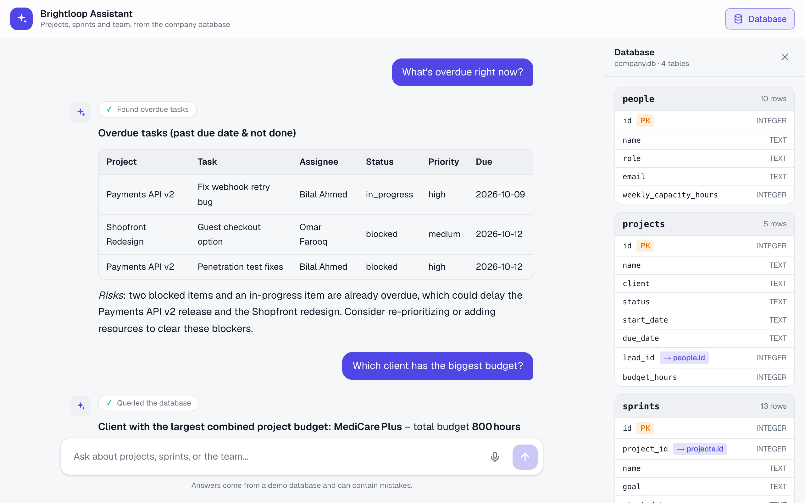

# AI Company Assistant

> Ask your company questions in plain English. Type or talk, and get answers straight from the database.

An AI assistant for a software agency, built with [Mastra](https://mastra.ai) and [Next.js](https://nextjs.org), running on [Groq](https://groq.com)'s free tier. It answers questions about projects, sprints, tasks, and team workload by querying a local SQLite database, so every answer is grounded in real data instead of guesses.

## Screenshots

<p align="center">
  
</p>

<table>
  <tr>
    <td width="50%" align="center">
      
      <br><sub><b>Home</b>: suggested questions to get started</sub>
    </td>
    <td width="50%" align="center">
      
      <br><sub><b>Schema panel</b>: browse the tables the assistant can query</sub>
    </td>
  </tr>
</table>

## What it does

The assistant plays the role of an internal helper for **Brightloop Studio**, a fictional software agency. You can ask things like:

- *Which projects are at risk?*
- *Is anyone overloaded this week?*
- *What's in the current sprint for the Clinic Booking App?*
- *Which client has the biggest budget?*
- *Show me everything that's overdue.*

Behind the scenes, the agent picks the right tool for the question, runs a query against the company database, and replies with a short, scannable answer. It also flags risks on its own, such as blocked tasks or people whose open work exceeds their weekly capacity.

## Features

| Feature | Details |
| --- | --- |
| **Purpose-built tools** | Fixed queries for projects, project status, sprint tasks, team workload, and overdue tasks |
| **Text-to-SQL fallback** | A read-only `SELECT` tool handles any question the fixed tools can't |
| **Voice chat** | Tap the mic, ask out loud, and hear the answer read back. Speech-to-text runs on Groq Whisper |
| **Conversation memory** | Each chat remembers its last 20 messages, so follow-ups work naturally |
| **Schema panel** | A side panel in the chat UI shows the database tables, columns, keys, and row counts |
| **Observability** | Traces are stored in DuckDB and viewable in Mastra Studio |
| **Safe by design** | The SQL tool runs in SQLite query-only mode, accepts a single `SELECT`, and caps results at 100 rows |

## Tech stack

- **[Mastra](https://mastra.ai)** for the agent, tools, memory, and observability
- **[Next.js](https://nextjs.org)** for the chat UI and API routes
- **[Groq](https://groq.com)** for the LLM (`openai/gpt-oss-120b`) and Whisper transcription
- **libSQL / SQLite** for company data and agent memory
- **DuckDB** for traces

## Getting started

### 1. Install

```shell
npm install
```

Requires Node.js 22.13 or newer.

### 2. Add your API key

Copy `.env.example` to `.env` and set your Groq key. You can get a free one at [console.groq.com](https://console.groq.com).

```shell
GROQ_API_KEY=your_key_here
```

### 3. Seed the database

```shell
npm run seed
```

This creates `company.db` with a fictional team, projects, sprints, and tasks. Run it again any time to reset the data.

### 4. Run it

```shell
npm run web    # Chat app (text and voice) at http://localhost:3000
npm run dev    # Mastra Studio at http://localhost:4111
```

You can run either or both. They share the same databases.

> **Note:** Groq's free tier has a per-minute token limit. If you ask several questions in quick succession, the app will show a short "rate limit" message. Wait about 10 seconds and try again.

## Using voice

Tap 🎤, ask your question, then tap ⏹. The audio is transcribed with Groq Whisper, sent to the agent, and the reply is read aloud by the browser. Spoken questions get shorter answers so they're easier to listen to.

## How it fits together

```
src/
├── app/
│   ├── page.tsx                  Chat page with voice input and schema panel
│   ├── schema-panel.tsx          Database structure viewer
│   └── api/
│       ├── chat/route.ts         Streams agent replies to the chat page
│       ├── transcribe/route.ts   Speech-to-text via Groq Whisper
│       └── schema/route.ts       Returns tables, columns, and row counts
└── mastra/
    ├── index.ts                  Registers the agent, storage, and observability
    ├── agents/company-agent.ts   Agent instructions, model, tools, and memory
    └── tools/company-tools.ts    Database tools and the text-to-SQL tool
scripts/
└── seed-company-db.ts            Creates and populates company.db
```

The chat route imports the Mastra instance directly, so there is no separate agent server to deploy.

## Storage

All databases live in the project root and are ignored by git.

| File | Purpose |
| --- | --- |
| `company.db` | The fictional company data (people, projects, sprints, tasks) |
| `mastra.db` | Agent conversation memory |
| `mastra.duckdb` | Traces for Mastra Studio |
